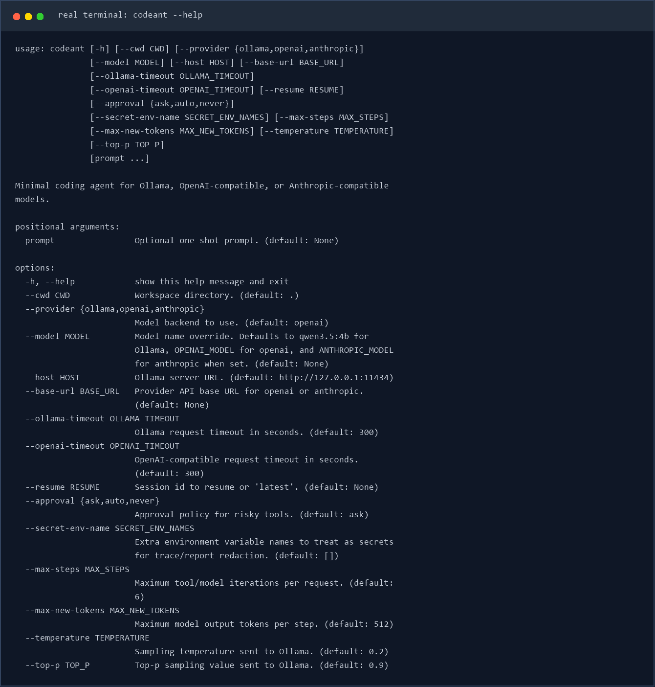
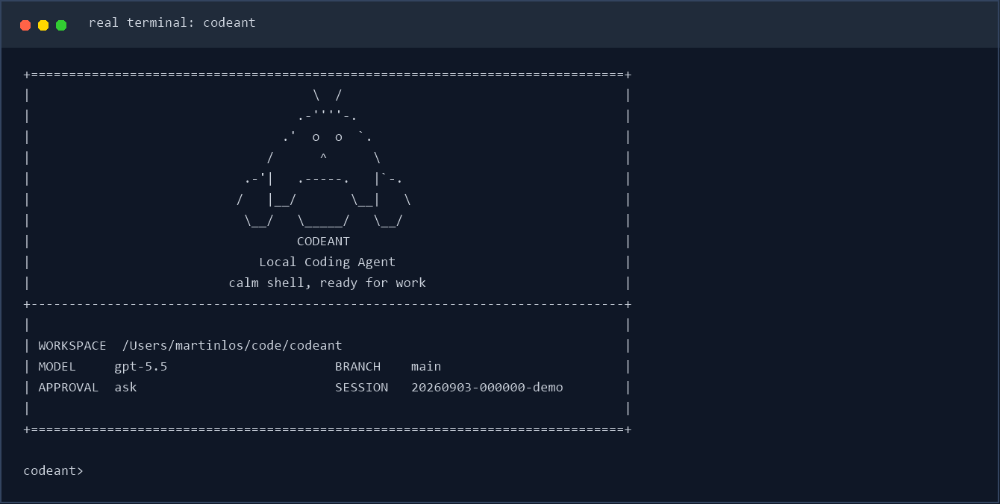
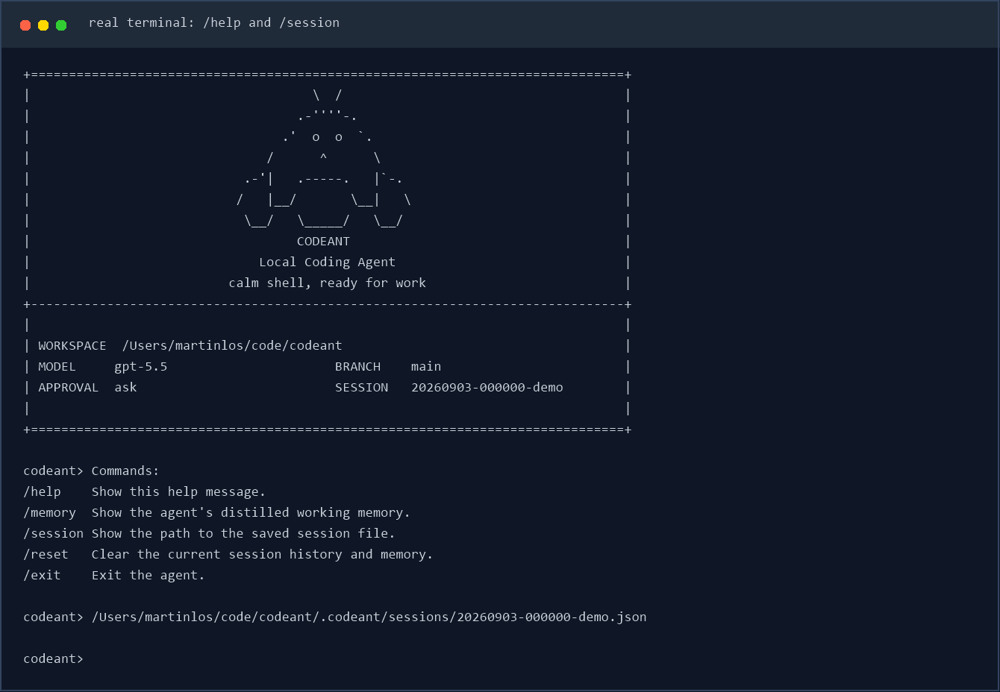

# CodeAnt

`CodeAnt` 是一个面向代码仓库的轻量本地 coding agent。它直接跑在终端里，先看当前工作区，再用一组受约束的工具去读文件、改文件、跑命令，并把会话状态保存在本地 `.codeant/` 目录里。

它更像一个能在仓库里持续工作的命令行助手，不是纯聊天窗口。你可以拿它做代码排查、测试修复、仓库分析，或者让它在当前项目里执行一次性的工程任务。

## 适合做什么

- 在本地仓库里排查测试失败
- 读取当前代码结构并给出修改建议
- 基于现有文件做小步迭代，而不是脱离仓库空想
- 在会话中保留上下文，支持继续上一次工作

## 主要特性

- 包名是 `codeant`
- CLI 命令是 `codeant`
- 模块入口是 `python -m codeant`
- 会话保存在 `.codeant/sessions/`
- 每次运行的工件保存在 `.codeant/runs/<run_id>/`
- 支持三类模型后端：
  - Ollama
  - OpenAI 兼容 Responses API
  - Anthropic 兼容 Messages API

## 使用截图

CLI 帮助信息：



启动界面：



REPL 内置命令与会话路径：



## 安装

需要 Python 3.10+。

如果你用 `uv`，直接安装依赖：

```bash
uv sync
```

如果你已经在自己的 Python 环境里工作，也可以直接装成可编辑模式：

```bash
pip install -e .
```

## 快速开始

在当前仓库里启动交互模式：

```bash
uv run codeant
```

指定另一个工作目录：

```bash
uv run codeant --cwd /path/to/repo
```

直接跑一次性任务：

```bash
uv run codeant "inspect the test failures and propose a fix"
```

如果当前环境已经安装过包，也可以直接这样启动：

```bash
python -m codeant
```

## 模型后端

### Ollama

```bash
ollama serve
ollama pull qwen3.5:4b
uv run codeant --provider ollama --model qwen3.5:4b
```

### OpenAI 兼容接口

```bash
export OPENAI_API_BASE="https://your-api.example/v1"
export OPENAI_API_KEY="your-api-key"
export OPENAI_MODEL="gpt-5.4"
uv run codeant --provider openai
```

### Anthropic 兼容接口

```bash
export ANTHROPIC_API_BASE="https://www.right.codes/claude/v1"
export ANTHROPIC_API_KEY="your-api-key"
export ANTHROPIC_MODEL="claude-sonnet-4-6"
uv run codeant --provider anthropic
```

如果你的服务端对多个兼容接口复用了同一套密钥，`CodeAnt` 也支持从 `ANTHROPIC_API_KEY` 回退到 `RIGHT_CODES_API_KEY` 或 `OPENAI_API_KEY`。

## 常用交互命令

- `/help`：查看内置命令
- `/memory`：查看提炼后的工作记忆
- `/session`：查看当前会话文件路径
- `/reset`：清空当前会话状态
- `/exit` 或 `/quit`：退出 REPL

## 安全与持久化

`CodeAnt` 不会默认把所有动作都放开。像 shell 执行、文件写入这类高风险操作，会受审批模式控制：

- `--approval ask`
- `--approval auto`
- `--approval never`

每次运行结束后，都会在 `.codeant/runs/<run_id>/` 下写出这些文件：

- `task_state.json`
- `trace.jsonl`
- `report.json`

这些内容默认只保存在本地，不需要跟仓库一起提交。

## 开发

如果装了 Ruff，可以这样检查：

```bash
uv run ruff check .
```

## AntProof：可验证交付

AntProof 在模型提交最终答案前执行可审计的验证契约，用来确认代码检查、测试命令和工作区变更是否符合预期。契约可以放在仓库的 `.codeant/proof.json`，也可以通过 CLI 传入验证命令。

```json
{
  "schema_version": 1,
  "mode": "strict",
  "expects_changes": true,
  "allowed_change_paths": ["codeant/**", "tests/**"],
  "checks": [
    {"id": "tests", "command": "python -m pytest -q", "required": true, "timeout": 60}
  ]
}
```

常用参数：

```bash
uv run codeant --proof auto
uv run codeant --proof strict --proof-repair-rounds 2
uv run codeant --verify-command "python -m pytest -q"
```

`auto` 在没有契约时保持兼容并跳过验证；`strict` 没有契约或必需检查未通过时不会把任务标记为成功；`off` 完全关闭 AntProof。每次运行的验证结果会写入 `.codeant/runs/<run_id>/proof.json`，并可在 REPL 中用 `/proof` 查看。

安全提示：proof 配置中的验证命令会以当前用户权限在工作区执行，和运行测试脚本一样属于可执行代码。只对信任的仓库启用自动审批，并检查 `.codeant/proof.json` 内容；审批策略仍由 `--approval` 控制。

## 结构化任务规划

CodeAnt 支持采用 Pydantic + LangGraph 的结构化任务规划：Pydantic 负责校验计划、步骤依赖、风险和验收标准；LangGraph 负责按依赖推进步骤状态，不直接执行文件或 shell 副作用。

启用规划：

```bash
uv run codeant --plan auto
uv run codeant --plan strict --plan-max-tokens 900
```

- `off`：默认模式，保持原有模型-工具循环。
- `auto`：规划生成失败时使用安全的单步 fallback，并在运行报告中保留警告。
- `strict`：规划生成失败会阻止任务被标记为成功。

每次启用规划的运行会在 `.codeant/runs/<run_id>/plan.json` 保存脱敏的计划、状态和事件；模型完成步骤时可发送 `<plan_step_done id="step-id">evidence</plan_step_done>`，运行时会校验步骤和依赖并更新当前步骤。REPL 中可使用 `/plan` 查看计划摘要。

步骤还可以声明 `allowed_tools`、`allowed_paths` 和 `verification_commands`。启用这些约束后，CodeAnt 会在工具执行前拦截越权操作，并在接受 `<plan_step_done>` 前通过 AntProof 审批边界运行步骤级验证；验证失败会保留当前步骤并把证据反馈给模型。

### v0.5 失败修复、自动重规划与断点恢复

启用规划后，工具拒绝、工具执行错误或步骤验收失败都会写入 `failure_counts` 与验证证据。达到 `--plan-repair-rounds` 后，CodeAnt 会把失败原因和已完成步骤交给规划器生成新计划；`--plan-max-replans` 控制每次请求的重规划上限，达到上限时会以可解释的阻塞状态停止。`plan.json`、检查点和运行报告会保存重规划历史。

每次工具执行都会创建检查点，检查点包含计划产物路径、当前步骤、已完成步骤和重规划历史。使用 `--resume <session-id>`（或 `--resume latest`）时，CodeAnt 会校验检查点和工作区新鲜度，恢复未完成计划并从当前步骤继续，不会重复调用初始规划器。
